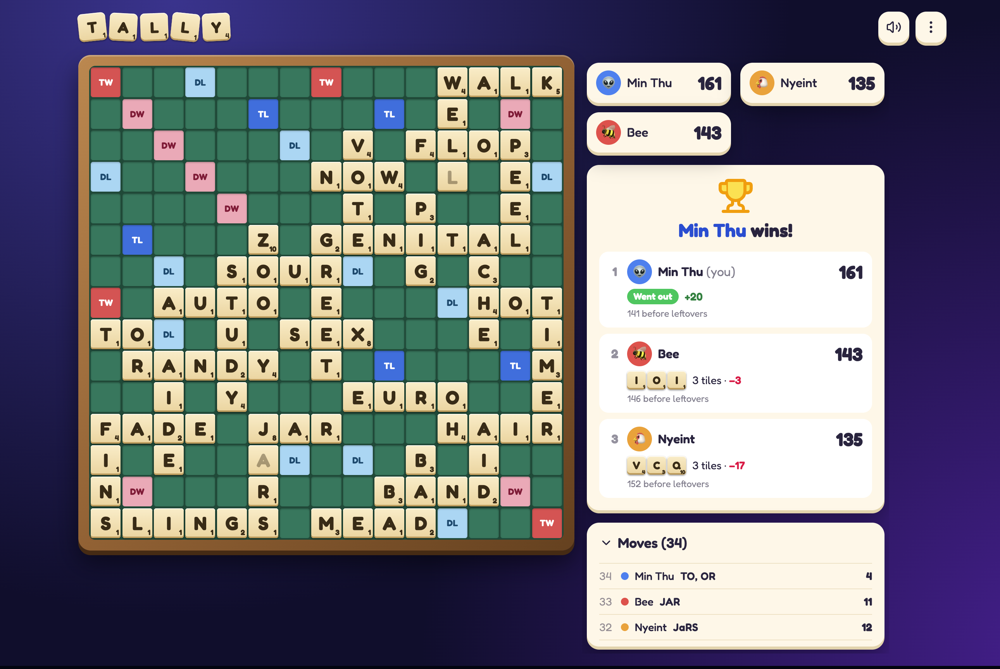

# Tally

Scrabble for 2–4 players on a full 15×15 board. Use it as a score tracker at the table, or play with friends online.



## Features

- **Score tracker** — runs in the browser, no account. Place words on the board and it scores them (premium squares, cross words, blanks, +50 bingo). Undo, history and end-of-game leftovers included. Works offline as a PWA.
- **Play online** — create a room, share the code or link, and play in real time. The server deals tiles and checks every move against a 267k-word list.
- Optional turn timer (1:30 to 10:00)
- In-game chat with quick reactions
- Drag and drop tiles (mouse and touch)
- Player avatars, sounds and a last-word highlight

## Tech stack

| Part         | Tech                                                                     |
| ------------ | ------------------------------------------------------------------------ |
| Web app      | SvelteKit 3, Svelte 5, TypeScript, Tailwind CSS 4                        |
| Server       | Go 1.24, Postgres                                                        |
| Realtime     | Pusher (falls back to polling)                                           |
| Shared rules | `@tally/game` (TypeScript), ported to Go and tested on the same fixtures |
| Tooling      | Bun workspaces, Vitest, Playwright, Prettier, ESLint                     |

## Repo layout

```
apps/web        SvelteKit app (tracker + online client)
apps/server     Go API for online rooms
packages/game   Shared game rules, tile bag and API types
```

## Getting started

You need [Bun](https://bun.sh), [Go 1.24](https://go.dev) and [Docker](https://www.docker.com) (for Postgres).

```sh
bun install
docker compose up -d     # Postgres for the server
```

Copy the env files and fill them in:

```sh
cp apps/web/.env.example apps/web/.env
cp apps/server/.env.example apps/server/.env
```

Run the server and the web app:

```sh
cd apps/server && go run ./cmd/server   # API on :8787
bun run dev                            # web app on :5173
```

Leave the Pusher variables empty to run without realtime; the app will poll the server instead.

## Scripts

Run from the repo root:

```sh
bun run dev      # web dev server
bun run build    # web production build
bun run check    # type check
bun run lint     # prettier + eslint
bun run format   # prettier --write
bun run test     # all tests
```

## Environment variables

**Web** (`apps/web/.env`, built into the bundle):

- `API_URL` — online server URL
- `PUSHER_KEY`, `PUSHER_CLUSTER` — Pusher app (empty = polling)

**Server** (`apps/server/.env`):

- `PORT`, `DATABASE_URL`, `CORS_ORIGIN`
- `PUSHER_APP_ID`, `PUSHER_KEY`, `PUSHER_SECRET`, `PUSHER_CLUSTER`

## Word list

From [scrabble-wordscore-api](https://github.com/yusuf-musleh/scrabble-wordscore-api) (`acceptable_words.txt`).
